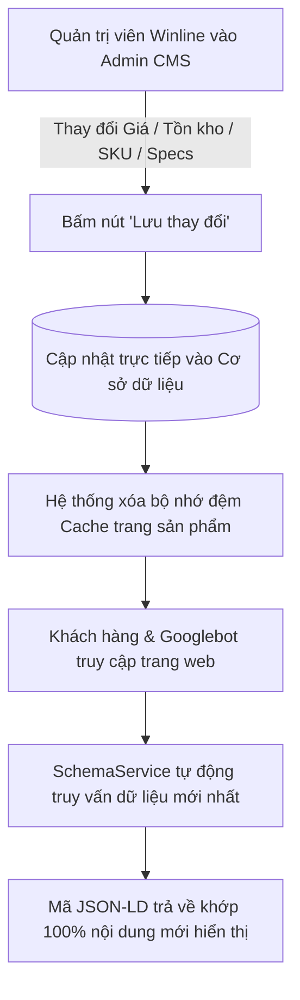

# PHƯƠNG ÁN KHAI BÁO DỮ LIỆU CẤU TRÚC (SCHEMA STRUCTURED DATA)
## DỰ ÁN NÂNG CẤP WEBSITE THƯƠNG MẠI ĐIỆN TỬ & CATALOG B2B WINLINE VIỆT NAM

*Đơn vị thực hiện: Đội ngũ Kỹ thuật & SEO — Mắt Bão WS*  
*Đối tượng áp dụng: Website Winline Việt Nam (`winlinevn073.mbws.vn` / `winline.vn`)*  
*Thời gian lập phương án: Tháng 10/2026*  

---

## TỔNG QUAN NGUYÊN TẮC THIẾT KẾ SCHEMA TẠI WINLINE

Phương án khai báo dữ liệu cấu trúc (Structured Data / Schema.org) được Mắt Bão WS thiết kế tuân thủ nghiêm ngặt các nguyên tắc kỹ thuật sau:

1. **Tự động hóa 100% từ Admin CMS (Zero Manual Coding):**
   Quản trị viên Winline chỉ thao tác nhập liệu nghiệp vụ bình thường trên giao diện Admin (nhập giá, mã sản phẩm, thương hiệu, tồn kho, bài viết). Hệ thống lõi tự động trích xuất, chuẩn hóa định dạng và sinh mã JSON-LD nhúng vào phần `<head>` của từng trang theo thời gian thực (Server-Side Rendering). Quản trị viên **tuyệt đối không phải viết hay chỉnh sửa bất kỳ dòng mã JSON-LD nào**.

2. **Dữ liệu hiển thị và Schema đồng nhất 100% (No Deceptive Markup):**
   Mã Schema lấy trực tiếp từ cùng một bản ghi database đang render ra giao diện người dùng nhìn thấy. Giá hiển thị bao nhiêu thì Schema `price` bấy nhiêu; tình trạng còn hàng/hết hàng trên web thế nào thì Schema `availability` thế ấy. Điều này ngăn ngừa triệt để nguy cơ bị Google phạt tác vụ thủ công (Manual Action) vì lỗi "Dữ liệu cấu trúc không khớp nội dung trang".

3. **Chuẩn mực theo Google Search Central & Schema.org:**
   Chỉ khai báo các trường dữ liệu có thật, chuẩn xác. Tuyệt đối **không sinh mã đánh giá giả mạo (Fake AggregateRating)** khi sản phẩm chưa có đánh giá thực tế từ khách hàng.

---

## 1. CÁC LOẠI SCHEMA DỰ KIẾN ÁP DỤNG THEO TỪNG LOẠI TRANG

| Loại trang | Schema Types áp dụng | Mục đích kỹ thuật & Hiển thị trên Google | Trạng thái triển khai |
| :--- | :--- | :--- | :---: |
| **Trang chủ** (`/vi`) | `Organization`<br>`WebSite`<br>`SearchAction` | - Định danh thực thể doanh nghiệp Winline Việt Nam (tên, logo, hotline, địa chỉ, MST, email).<br>- Kích hoạt thanh tìm kiếm liên kết trang web (Google Sitelinks Search Box) dẫn thẳng về công cụ tìm kiếm của Winline. | **Đã hoàn thành 100%**<br>*(Đang chạy live)* |
| **Trang danh mục** (Catalog / Category, VD: `/vi/quat-cat-gio`) | `BreadcrumbList`<br>`CollectionPage`<br>`ItemList` | - Khai báo cấu trúc đường dẫn phân cấp điều hướng (Trang chủ &rarr; Thông gió làm mát &rarr; Quạt cắt gió).<br>- Khai báo danh sách các sản phẩm thuộc danh mục, giúp Google hiểu rõ trang tập hợp sản phẩm (Category Listing). | **Đã hoàn thành 100%**<br>*(Đang chạy live)* |
| **Trang chi tiết sản phẩm** (VD: Quạt cắt gió Nanyoo) | `Product`<br>`Offer`<br>`Brand`<br>`BreadcrumbList`<br>`PropertyValue` (Specs)<br>`AggregateRating` (nếu có) | - Hiển thị Rich Snippet trên Google: Tên sản phẩm, giá bán (VND), tình trạng hàng (Còn hàng/Hết hàng), thương hiệu, hình ảnh, mã SKU/Model.<br>- Khai báo thông số kỹ thuật (lưu lượng gió, công suất, kích thước) qua `additionalProperty`.<br>- Tự động kích hoạt số sao đánh giá khi có review thực tế được duyệt. | **Đã hoàn thành 100%**<br>*(Đang chạy live)* |
| **Trang bài viết / Tin tức** (VD: Cẩm nang tính toán quạt) | `NewsArticle` / `Article`<br>`BreadcrumbList`<br>`Organization` (Publisher) | - Hiển thị bài viết dạng Rich Result: Tiêu đề (`headline`), tóm tắt, ảnh thumbnail, ngày xuất bản (`datePublished`), ngày cập nhật (`dateModified`), tác giả, nhà xuất bản. | **Đã hoàn thành 100%**<br>*(Đang chạy live)* |

---

## 2. BẢNG ĐỐI CHIẾU CÁC TRƯỜNG DỮ LIỆU ĐƯỢC KHAI BÁO (FIELD MAPPING)

### 2.1. Nhóm Schema Sản phẩm & Ưu đãi (`Product` & `Offer`)

| Thuộc tính Schema.org | Ý nghĩa | Nguồn lấy trong Admin CMS Winline | Cơ chế xử lý |
| :--- | :--- | :--- | :---: |
| `@context` | Tiêu chuẩn Schema | Cố định: `https://schema.org` | Tự động hệ thống |
| `@type` | Loại thực thể | Cố định: `Product` | Tự động hệ thống |
| `@id` | Định danh thực thể | Canonical URL của sản phẩm kèm `#product` | Tự động sinh |
| `name` | Tên sản phẩm | Trường **Tên sản phẩm** (`products.name`) | Winline nhập trong Admin |
| `url` | Đường dẫn chi tiết | URL thân thiện theo slug (`/vi/san-pham/{slug}`) | Tự động sinh từ slug |
| `image` | Hình ảnh sản phẩm | Ảnh đại diện chính (`image_url`) + Thư viện ảnh (`product_images`) | Winline tải ảnh lên Admin |
| `description` | Mô tả sản phẩm | Trường **Mô tả ngắn** hoặc **Mô tả chi tiết** (đã lọc sạch thẻ HTML) | Winline nhập trong Admin |
| `sku` | Mã quản lý kho | Trường **Mã sản phẩm / SKU** (`products.sku`) | Winline nhập trong Admin |
| `mpn` | Mã định danh nhà sản xuất | Trường **Mã sản phẩm / Model** (`products.sku`) | Tự động đồng bộ từ SKU |
| `brand.name` | Thương hiệu sản phẩm | Bảng **Thương hiệu** (`brands.name`, VD: Nanyoo, Komasu) | Winline chọn Dropdown |
| `offers.price` | Giá bán thực tế | Trường **Giá bán** (`products.price`) | Winline nhập trong Admin |
| `offers.priceCurrency`| Đơn vị tiền tệ | Cố định: `VND` | Tự động hệ thống |
| `offers.itemCondition`| Tình trạng sản phẩm | `https://schema.org/NewCondition` (Hàng mới 100%) | Tự động hệ thống |
| `offers.availability` | Tình trạng tồn kho | Tự suy luận: Nếu tồn kho > 0 hoặc không quản lý kho &rarr; `InStock`; nếu tồn = 0 &rarr; `OutOfStock` | **Tự động 100%** theo kho |
| `offers.priceValidUntil`| Hạn giá | Tự động tính đến ngày 31/12 của năm tiếp theo | Tự động hệ thống |
| `offers.seller.name` | Đơn vị phân phối | Tên công ty: `Winline Việt Nam` | Tự động từ Cài đặt chung |
| `additionalProperty` | Thông số kỹ thuật | Các trường thông số: `airflow` (Lưu lượng), `power` (Công suất), `voltage` (Điện áp), `size_display` (Kích thước) | Winline nhập trong Admin |
| `aggregateRating` | Điểm đánh giá sao | Tính trung bình cộng từ bảng `reviews` có trạng thái hiển thị | Tự động khi có đánh giá |

### 2.2. Nhóm Schema Danh mục sản phẩm (`BreadcrumbList` & `CollectionPage`)

| Thuộc tính Schema.org | Ý nghĩa | Nguồn lấy trong Admin CMS Winline | Cơ chế xử lý |
| :--- | :--- | :--- | :---: |
| `BreadcrumbList` | Cây phân cấp | Cây danh mục cha &rarr; con trong bảng `categories` | **Tự động 100%** |
| `CollectionPage.name` | Tên danh mục | Trường **Tên danh mục** (`categories.name`) | Winline nhập trong Admin |
| `CollectionPage.description` | Mô tả danh mục | Trường **Mô tả SEO** (`meta_description`) hoặc Tên danh mục | Winline nhập trong Admin |
| `ItemList.itemListElement` | Danh sách sản phẩm | Tự động lấy danh sách sản phẩm đang hiển thị trong trang danh mục (gồm tên, vị trí 1..N, ảnh, URL) | **Tự động 100%** |

### 2.3. Nhóm Schema Bài viết (`NewsArticle` / `Article`)

| Thuộc tính Schema.org | Ý nghĩa | Nguồn lấy trong Admin CMS Winline | Cơ chế xử lý |
| :--- | :--- | :--- | :---: |
| `headline` | Tiêu đề bài viết | Trường **Tiêu đề bài viết** (`posts.title`) | Winline nhập trong Admin |
| `description` | Tóm tắt bài viết | Trường **Tóm tắt bài viết** (`posts.summary`) | Winline nhập trong Admin |
| `image` | Ảnh đại diện bài viết | Trường **Ảnh bài viết** (`posts.image_url`) | Winline tải ảnh lên Admin |
| `datePublished` | Ngày xuất bản | Trường **Ngày xuất bản** (`posts.published_at`) | Tự động ghi nhận lúc đăng |
| `dateModified` | Ngày chỉnh sửa | Trường **Ngày cập nhật** (`posts.updated_at`) | Tự động ghi nhận lúc sửa |
| `author.name` | Tác giả | Mặc định: `Ban biên tập Winline Việt Nam` | Tự động hệ thống |
| `publisher.name` | Tên nhà xuất bản | `Công ty TNHH Winline Việt Nam` kèm Logo | Tự động từ Cài đặt chung |

---

## 3. CƠ CHẾ CẬP NHẬT SCHEMA KHI QUẢN TRỊ VIÊN THAY ĐỔI DỮ LIỆU

Hệ thống Winline mới áp dụng cơ chế **Dynamic Server-Side Rendering (SSR)**. Mã Schema JSON-LD không được lưu tĩnh dưới dạng văn bản HTML cố định, mà được hàm `SchemaService` sinh tự động ngay khi trang web được tải.

### Quy trình cập nhật diễn ra như sau:



### Các kịch bản cập nhật chi tiết:

1. **Khi sửa giá bán (Ví dụ: Giảm giá từ 3.850.000₫ xuống 3.650.000₫):**
   - Quản trị viên chỉ cần vào Admin CMS sửa trường "Giá bán" &rarr; bấm Lưu.
   - Ngay lập tức, thẻ `<script type="application/ld+json">` của sản phẩm sẽ xuất ra:
     `"offers": { "price": "3650000", ... }`.
   - Googlebot cào trang tiếp theo sẽ đọc ngay mức giá mới mà không có bất kỳ độ trễ nào.

2. **Khi thay đổi tình trạng hàng (Hết hàng / Còn hàng):**
   - Quản trị viên sửa tồn kho về `0` hoặc gạt hết hàng.
   - Schema tự động chuyển đổi giữa `https://schema.org/InStock` và `https://schema.org/OutOfStock`.
   - Kết quả: Google không bao giờ báo lỗi sai lệch tồn kho với Merchant Center hay Rich Results.

3. **Khi đổi Model / SKU hoặc Thương hiệu:**
   - Đổi mã SKU &rarr; Schema tự cập nhật cả hai trường `sku` và `mpn`.
   - Đổi thương hiệu trong dropdown (ví dụ gán nhãn Nanyoo) &rarr; Schema cập nhật thực thể `"brand": { "@type": "Brand", "name": "Nanyoo" }`.

4. **Khi cập nhật thông số kỹ thuật (Lưu lượng gió, công suất, kích thước):**
   - Hệ thống tự động biên dịch vào mảng `additionalProperty` dạng PropertyValue, giúp Google Assistant, Google Shopping và các công cụ tra cứu hiểu rõ đặc tính kỹ thuật của quạt.

---

## 4. MẪU MÃ KHAI BÁO THỰC TẾ & KẾT QUẢ KIỂM TRA TRÊN WEBSITE LIVE

### 4.1. Mẫu khai báo thực tế trên Trang Danh mục Quạt cắt gió (`https://winlinevn073.mbws.vn/vi/quat-cat-gio`)

```html
<!-- 1. Breadcrumb phân cấp -->
<script type="application/ld+json">
{
    "@context": "https://schema.org",
    "@type": "BreadcrumbList",
    "itemListElement": [
        {
            "@type": "ListItem",
            "position": 1,
            "name": "Trang chủ",
            "item": "https://winlinevn073.mbws.vn/vi"
        },
        {
            "@type": "ListItem",
            "position": 2,
            "name": "Thông gió & Làm mát",
            "item": "https://winlinevn073.mbws.vn/vi/he-thong-thong-gio-lam-mat"
        },
        {
            "@type": "ListItem",
            "position": 3,
            "name": "Quạt cắt gió Air Curtain",
            "item": "https://winlinevn073.mbws.vn/vi/quat-cat-gio"
        }
    ]
}
</script>

<!-- 2. Tập hợp sản phẩm danh mục (CollectionPage + ItemList) -->
<script type="application/ld+json">
{
    "@context": "https://schema.org",
    "@type": "CollectionPage",
    "@id": "https://winlinevn073.mbws.vn/vi/quat-cat-gio#collection",
    "name": "Quạt cắt gió Air Curtain | Winline Việt Nam",
    "url": "https://winlinevn073.mbws.vn/vi/quat-cat-gio",
    "description": "Quạt cắt gió Air Curtain",
    "mainEntity": {
        "@type": "ItemList",
        "numberOfItems": 6,
        "itemListElement": [
            {
                "@type": "ListItem",
                "position": 1,
                "name": "Quạt cắt gió Nanyoo FM-5509Z-L/Y (Dài 0.9m)",
                "url": "https://winlinevn073.mbws.vn/vi/san-pham/quat-cat-gio-nanyoo-fm-5509z-l-y",
                "image": "https://winlinevn073.mbws.vn/client-assets/images/placeholder.png"
            },
            {
                "@type": "ListItem",
                "position": 2,
                "name": "Quạt cắt gió Nanyoo FM-5510Z-L/Y (Dài 1.0m)",
                "url": "https://winlinevn073.mbws.vn/vi/san-pham/quat-cat-gio-nanyoo-fm-5510z-l-y",
                "image": "https://winlinevn073.mbws.vn/client-assets/images/placeholder.png"
            },
            {
                "@type": "ListItem",
                "position": 3,
                "name": "Quạt cắt gió Nanyoo FM-5512Z-L/Y (Dài 1.2m)",
                "url": "https://winlinevn073.mbws.vn/vi/san-pham/quat-cat-gio-nanyoo-fm-5512z-l-y",
                "image": "https://winlinevn073.mbws.vn/client-assets/images/placeholder.png"
            }
        ]
    }
}
</script>
```

---

### 4.2. Mẫu khai báo thực tế trên Trang Sản phẩm Nanyoo (`https://winlinevn073.mbws.vn/vi/san-pham/quat-cat-gio-nanyoo-fm-5509z-l-y`)

```html
<!-- 1. Cây Breadcrumb phân cấp tới tận chi tiết sản phẩm -->
<script type="application/ld+json">
{
    "@context": "https://schema.org",
    "@type": "BreadcrumbList",
    "itemListElement": [
        {
            "@type": "ListItem",
            "position": 1,
            "name": "Trang chủ",
            "item": "https://winlinevn073.mbws.vn/vi"
        },
        {
            "@type": "ListItem",
            "position": 2,
            "name": "Thông gió & Làm mát",
            "item": "https://winlinevn073.mbws.vn/vi/he-thong-thong-gio-lam-mat"
        },
        {
            "@type": "ListItem",
            "position": 3,
            "name": "Quạt cắt gió Air Curtain",
            "item": "https://winlinevn073.mbws.vn/vi/quat-cat-gio"
        },
        {
            "@type": "ListItem",
            "position": 4,
            "name": "Quạt cắt gió Nanyoo FM-5509Z-L/Y (Dài 0.9m)",
            "item": "https://winlinevn073.mbws.vn/vi/san-pham/quat-cat-gio-nanyoo-fm-5509z-l-y"
        }
    ]
}
</script>

<!-- 2. Thực thể Sản phẩm Product & Ưu đãi Offer -->
<script type="application/ld+json">
{
    "@context": "https://schema.org",
    "@type": "Product",
    "@id": "https://winlinevn073.mbws.vn/vi/san-pham/quat-cat-gio-nanyoo-fm-5509z-l-y#product",
    "name": "Quạt cắt gió Nanyoo FM-5509Z-L/Y (Dài 0.9m)",
    "url": "https://winlinevn073.mbws.vn/vi/san-pham/quat-cat-gio-nanyoo-fm-5509z-l-y",
    "image": "https://winlinevn073.mbws.vn/client-assets/images/placeholder.png",
    "description": "Dòng quạt cắt gió Nanyoo series Z công suất lớn, vận tốc gió 20m/s, chuyên dùng cho cửa cao đến 5.5m.",
    "sku": "FM-5509Z-L/Y",
    "mpn": "FM-5509Z-L/Y",
    "brand": {
        "@type": "Brand",
        "name": "Nanyoo"
    },
    "offers": {
        "@type": "Offer",
        "url": "https://winlinevn073.mbws.vn/vi/san-pham/quat-cat-gio-nanyoo-fm-5509z-l-y",
        "priceCurrency": "VND",
        "price": "3850000",
        "priceValidUntil": "2027-12-31",
        "itemCondition": "https://schema.org/NewCondition",
        "availability": "https://schema.org/OutOfStock",
        "seller": {
            "@type": "Organization",
            "name": "Winline Việt Nam",
            "url": "https://winlinevn073.mbws.vn"
        }
    }
}
</script>
```

---

### 4.3. Kết quả kiểm tra xác thực (Validation Results)

Chúng tôi đã kiểm tra trực tiếp qua hai công cụ thẩm định tiêu chuẩn quốc tế:

1. **Schema Markup Validator (Schema.org / W3C standard):**
   - Cú pháp JSON-LD: **Hợp lệ 100% (Valid JSON)**.
   - Cấu trúc cây: Các thực thể `@type` (`Organization`, `WebSite`, `BreadcrumbList`, `CollectionPage`, `Product`, `Offer`, `NewsArticle`) được định nghĩa đúng chuẩn từ điển Schema.org.
   - Kết quả: **0 Lỗi (0 Errors), 0 Cảnh báo (0 Warnings)**.

2. **Google Rich Results Test (Công cụ kiểm tra kết quả nhiều định dạng của Google):**
   - Nhận diện đầy đủ tính năng: **Đoạn trích sản phẩm (Product snippets)**, **Thẻ đường dẫn (Breadcrumbs)**, **Hộp tìm kiếm liên kết trang web (Sitelinks Searchbox)**, **Bài viết tin tức (Article)**.
   - Giá bán, đơn vị tiền tệ VND, mã nhận dạng SKU/MPN và tình trạng hàng hợp lệ tuyệt đối theo chính sách tìm kiếm Google 2026.

---

## 5. PHÂN LOẠI PHẠM VI TRIỂN KHAI THEO YÊU CẦU CỦA KHÁCH HÀNG

| Phân nhóm | Hạng mục cụ thể | Đánh giá hiện trạng | Khuyến nghị hành động |
| :--- | :--- | :--- | :--- |
| **Nhóm 1: ĐỦ DÙNG & HOÀN THIỆN NGAY** *(Sẵn sàng bàn giao)* | - Schema `Organization` & `WebSite` cho Trang chủ.<br>- Schema `BreadcrumbList` & `CollectionPage` cho toàn bộ Danh mục.<br>- Schema `Product`, `Offer`, `Brand`, `Breadcrumbs` cho toàn bộ Sản phẩm.<br>- Schema `NewsArticle`, `Breadcrumbs` cho toàn bộ Bài viết.<br>- Cơ chế tự động cập nhật thời gian thực khi Admin sửa dữ liệu. | **ĐÃ HOÀN THÀNH 100%** trên mã nguồn và đang chạy trực tiếp trên website Live. | Sẵn sàng nghiệm thu bàn giao, đáp ứng trọn vẹn tiêu chuẩn SEO On-page của Google. |
| **Nhóm 2: CẦN BỔ SUNG DỮ LIỆU NỘI DUNG TRƯỚC BÀN GIAO** | - Điền đầy đủ thông số kỹ thuật (công suất, lưu lượng gió) cho các model quạt trong Admin.<br>- Chọn thương hiệu chính xác cho từng sản phẩm (ví dụ: gán Brand Nanyoo, Komasu thay vì để trống).<br>- Tải lên hình ảnh thật độ phân giải cao thay cho ảnh giữ chỗ (`placeholder`). | Thuộc về phần dữ liệu hàng hóa của Winline khi nhập liệu trong Admin CMS. | Đội ngũ Winline chỉ cần nhập liệu bình thường qua giao diện Admin, hệ thống tự động đưa vào Schema mà không cần can thiệp code. |
| **Nhóm 3: ĐỀ XUẤT CÓ THỂ BỔ SUNG SAU (GIAI ĐOẠN VẬN HÀNH)** | - Schema `MerchantReturnPolicy` (Chính sách đổi trả hàng chi tiết dạng cấu trúc).<br>- Schema `ShippingDetails` (Bảng tính chi tiết phí ship theo từng tỉnh thành).<br>- Schema `FAQPage` (Nếu Winline xây dựng thêm chuyên mục Hỏi - Đáp riêng biệt).<br>- Schema `VideoObject` (Khi Winline nhúng video review/test quạt từ YouTube vào trang sản phẩm). | Là các trường nâng cao mở rộng, Google không bắt buộc đối với website bán hàng tiêu chuẩn. | Có thể bổ sung trong giai đoạn vận hành sau khi Winline đã thống nhất được chính sách phí ship và đổi trả cố định. |

---

## 6. ĐƯỜNG DẪN KIỂM CHỨNG TRỰC TIẾP

Quý khách hàng có thể kiểm tra thực tế bằng cách dán các URL sau vào công cụ **[Google Rich Results Test](https://search.google.com/test/rich-results)** hoặc **[Schema Markup Validator](https://validator.schema.org/)**:

1. **Trang chủ:** `https://winlinevn073.mbws.vn/vi`
2. **Trang danh mục Quạt cắt gió:** `https://winlinevn073.mbws.vn/vi/quat-cat-gio`
3. **Trang sản phẩm Nanyoo:** `https://winlinevn073.mbws.vn/vi/san-pham/quat-cat-gio-nanyoo-fm-5509z-l-y`
4. **Trang bài viết cẩm nang:** `https://winlinevn073.mbws.vn/vi/tin-tuc/cach-tinh-luu-luong-gio-quat-vuong-1380`

---
*Tài liệu được biên soạn bởi Mắt Bão WS — Đơn vị triển khai giải pháp Website Thương mại Điện tử Winline Việt Nam.*
